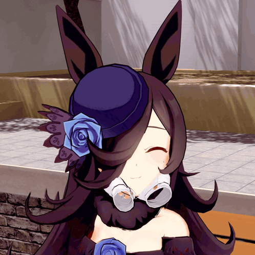

<!-- Repositório: luckz676/luckz676 (precisa ser PÚBLICO) -->

<div align="center">


<table>
<tr>
<td align="center" width="260">

</td>
<td align="left">

<a href="https://github.com/luckz676">

</a>

<br/>


</td>
</tr>
</table>

</div>


## 👋 Sobre mim

```python
class Lucas:
    username = "luckz676"
    especializacao = "Inteligência Artificial"
    foco = ["agentes autônomos", "automação de workflows", "apps com IA"]
    jogando = "Umamusume (time Rice Shower 💙🌹)"
    musica = "Sweet Child o' Mine"
    doce = "pavê"

    def entrega(self):
        return "código pronto, schema pronto, prompt pronto"
```

- 🧠 IA aplicada: do pipeline de dados ao produto rodando
- 🛠️ Prefiro entregar coisa que funciona a explicar teoria
- 🌱 Sempre estudando (cursos logo abaixo)
- 📫 Contato: _edite aqui_ (e-mail / LinkedIn / Telegram)


## 🧰 Stack

<!-- Edite: troque/remova badges conforme o que você realmente usa. Catálogo: https://shields.io / https://simpleicons.org -->
<div align="center">


</div>


## 🎓 Cursos

<!-- Uma linha por curso. Status: ✅ Concluído | 🔄 Em andamento | 📅 Planejado -->

| 📘 Curso | 🏫 Plataforma | ⏱️ Carga | Status |
|----------|---------------|:--------:|:------:|
| _Nome do curso de IA_ | _Plataforma_ | _00h_ | ✅ |
| _Nome do curso_ | _Plataforma_ | _00h_ | 🔄 |
| _Nome do curso_ | _Plataforma_ | _00h_ | 📅 |


## 📜 Certificados

<!--
  1. Suba as imagens na pasta  certificados/  (PNG/JPG) e os PDFs, se tiver.
  2. Troque os nomes abaixo. Cada <td> = um certificado; copie e cole para adicionar mais.
-->

<table align="center">
  <tr>
    <td align="center" width="33%">
      <a href="certificados/cert-1.pdf"></a>
      <br/><sub><b>Nome do curso</b><br/>Instituição · 2026</sub>
    </td>
    <td align="center" width="33%">
      <a href="certificados/cert-2.pdf"></a>
      <br/><sub><b>Nome do curso</b><br/>Instituição · 2026</sub>
    </td>
    <td align="center" width="33%">
      <a href="certificados/cert-3.pdf"></a>
      <br/><sub><b>Nome do curso</b><br/>Instituição · 2026</sub>
    </td>
  </tr>
</table>


## 🎸 Minha música favorita:

<div align="center">

### Sweet Child o' Mine — Guns N' Roses

<!--
  PLAYER TOCÁVEL (recomendado): o arquivo assets/sweet-child.mp4 já está pronto (6,4 MB).
  1. Abra o editor do README em github.com/luckz676/luckz676 (lápis).
  2. ARRASTE o assets/sweet-child.mp4 para dentro do texto, no lugar da linha COLE-AQUI.
  3. O GitHub gera uma URL https://github.com/user-attachments/assets/... — deixe só essa URL numa linha sozinha.
  4. Depois pode apagar o bloco "link provisório" logo abaixo.
-->

https://github.com/user-attachments/assets/COLE-AQUI-O-ID-DO-VIDEO

<!-- link provisório (funciona assim que você subir os arquivos): clique na Rice Shower para abrir o player -->
<a href="assets/sweet-child.mp4">
  
  <br/><sub>▶️ Clique na Rice Shower para ouvir</sub>
</a>

</div>


## 🐴 Umamusume

<table>
  <tr>
    <td width="200" align="center">
      
    </td>
    <td>
      <h3>💙🌹 Minha Uma favorita: Rice Shower</h3>
      Jogador de <b>Umamusume Pretty Derby</b>. A Rice Shower é a minha escolha, sem discussão.<br/><br/>
      
      
    </td>
  </tr>
</table>


## 🍮 Meu doce favorito: pavê

<div align="center">


</div>


## 📊 Atividade no GitHub

<div align="center">


</div>


