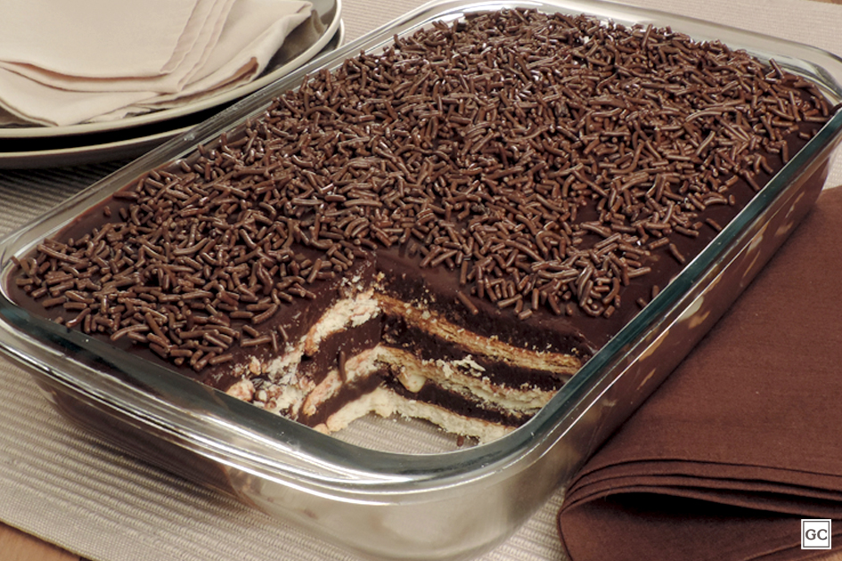

<!-- Repositório: luckz676/luckz676 (precisa ser PÚBLICO) -->

<table>
<tr>
<td align="center" width="260">

</td>
<td align="left">

 

</td>
</tr>
</table>

## 🧰 Stack

<!-- Edite: troque/remova badges conforme o que você realmente usa. Catálogo: https://shields.io / https://simpleicons.org
     Badges com pointer-events:none para tentar impedir o clique padrão do GitHub (que abre a imagem). Se ainda abrir, o fallback é linkar cada badge ao site oficial. -->

## 🎓 Cursos

<!-- Uma linha por curso. Status: ✅ Concluído | 🔄 Em andamento | 📅 Planejado -->

| 📘 Curso | 🏫 Instituição | Status |
|----------|----------------|:------:|
| _Nome do curso de IA_ | _Instituição_ | ✅ |
| _Nome do curso_ | _Instituição_ | 🔄 |
| _Nome do curso_ | _Instituição_ | 📅 |

## 📜 Certificados

<!--
  1. Suba as imagens na pasta  certificados/  (PNG/JPG) e os PDFs, se tiver.
  2. Troque os nomes abaixo. Cada <td> = um certificado; copie e cole para adicionar mais.
-->

<table align="center">
  <tr>
    <td align="center" width="33%">
      
       <b>Nome do curso</b> Instituição · 2026
    </td>
    <td align="center" width="33%">
      
       <b>Nome do curso</b> Instituição · 2026
    </td>
    <td align="center" width="33%">
      
       <b>Nome do curso</b> Instituição · 2026
    </td>
  </tr>
</table>

## 🎸 Minha música favorita:

**Sweet Child o' Mine** · Guns N' Roses

<!--
  PLAYER TOCÁVEL: trecho 0:30-1:00 (30s, amostra) em assets/sweet-child.mp4 (faixa baixa com forma de onda).
  1. Abra o editor do README em github.com/luckz676/luckz676 (lápis).
  2. ARRASTE o assets/sweet-child.mp4 para dentro do texto, aqui embaixo.
  3. O GitHub gera uma URL https://github.com/user-attachments/assets/... — deixe só essa URL numa linha sozinha.
-->

https://github.com/user-attachments/assets/d9c5229d-0c26-49ea-81db-3a86985e6d4d

## Eu jogo Umamusume 🐴

<table>
  <tr>
    <td width="420" align="center">
      
    </td>
    <td>
      <h3>💙🌹 Minha Uma favorita: Rice Shower</h3>
      Jogador de <b>Umamusume Pretty Derby</b>. A Rice Shower é a minha favorita, GOAT 🐐
    </td>
  </tr>
</table>

## Meu doce favorito: pavê

<table>
  <tr>
    <td>
      <h3>Camadas que fazem tudo valer a pena</h3>
      Pavê é a prova de que não precisa de forno nem de complicação para fazer uma sobremesa perfeita: bolacha macia, creme gelado e chocolate por cima. Cada garfada junta textura, doçura e aquele gosto de festa de família. Simples, generoso e impossível de comer só um pedaço. Doce favorito, sem concorrência.
    </td>
    <td width="360" align="center">
      
    </td>
  </tr>
</table>

## 📊 Atividade no GitHub

